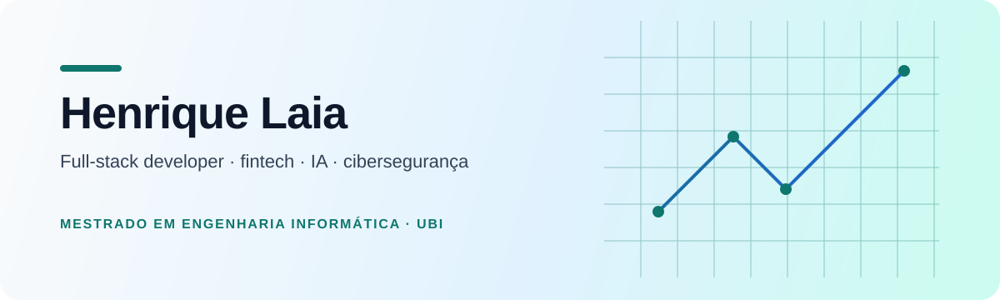

<picture>
  <source media="(prefers-color-scheme: dark)" srcset="https://raw.githubusercontent.com/henriquelaia/henriquelaia/main/assets/header-dark.svg">
  
</picture>

<div align="center">

[Portfólio](https://henriquelaia.pt) &nbsp;·&nbsp; [LinkedIn](https://pt.linkedin.com/in/henrique-laia) &nbsp;·&nbsp; [Contacto](https://henriquelaia.pt/#contact)

</div>

## Sobre

Construo produtos web que equilibram **experiência, segurança e utilidade real**. Estou a frequentar o **Mestrado em Engenharia Informática** na Universidade da Beira Interior, no percurso de **Virtualização e Cibersegurança**.

O meu trabalho cruza produto digital, fintech e IA aplicada — sempre com atenção à privacidade, performance e qualidade de implementação.

## Trabalho selecionado

| Projeto | Contexto | Tecnologias |
| :-- | :-- | :-- |
| **[GoldLock](https://goldlock.app)** | Plataforma de finanças pessoais para Portugal com Open Banking (PSD2), machine learning e IA generativa local. | React · TypeScript · Node.js · Python · PostgreSQL · Docker |
| **KeyZero** | Gestor de passwords zero-knowledge, vencedor do Shift to Digital. A cifra acontece no browser; o servidor nunca vê a Master Key. | React · Web Crypto API · WebAuthn · Node.js · MongoDB |
| **[Lucrar.pt](https://lucrar.pt)** | Desenvolvimento e manutenção de páginas rápidas e orientadas para conversão em ambiente de produção. | WordPress · Elementor · JavaScript · HTML · CSS |

## Capacidades

```text
PRODUCT & WEB        Interfaces React/Next.js, UX e desenvolvimento full-stack
DATA & BACKEND       Node.js, Python, PostgreSQL, MongoDB e integrações API
SECURITY              Autenticação, Web Crypto, privacidade e princípios zero-knowledge
DELIVERY              Git, Docker, AWS, Vercel e melhoria contínua
```

## Princípios

**Clareza antes de complexidade.** Resolver o problema certo, com tecnologia que faz sentido.  
**Segurança por defeito.** Privacidade e proteção não são extras no fim do projeto.  
**Detalhe que se sente.** Performance, acessibilidade e uma experiência consistente contam.

<div align="center">

---

**Aberto a colaborar em produtos web, protótipos e projetos com IA.**  
[henriquelaia.pt](https://henriquelaia.pt) · [LinkedIn](https://pt.linkedin.com/in/henrique-laia)

</div>
